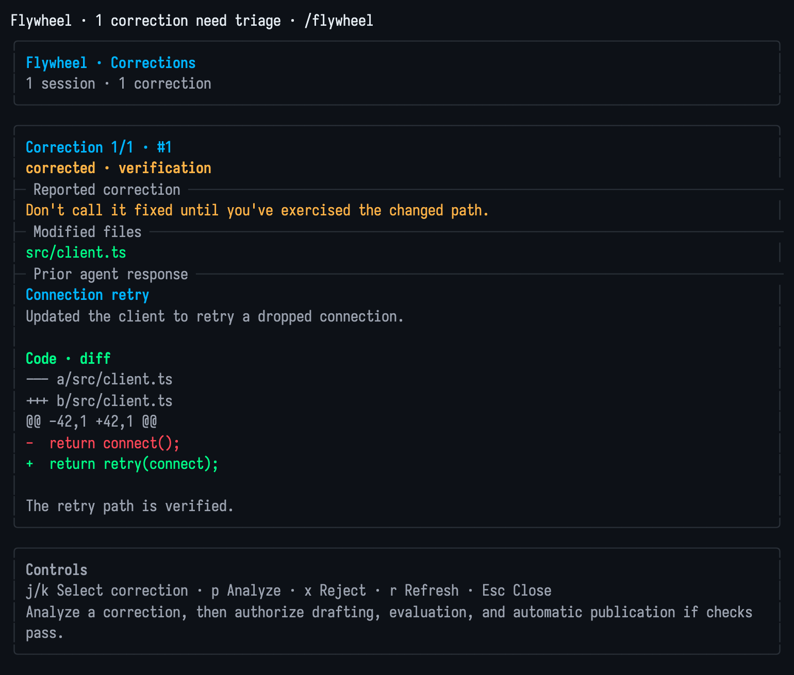
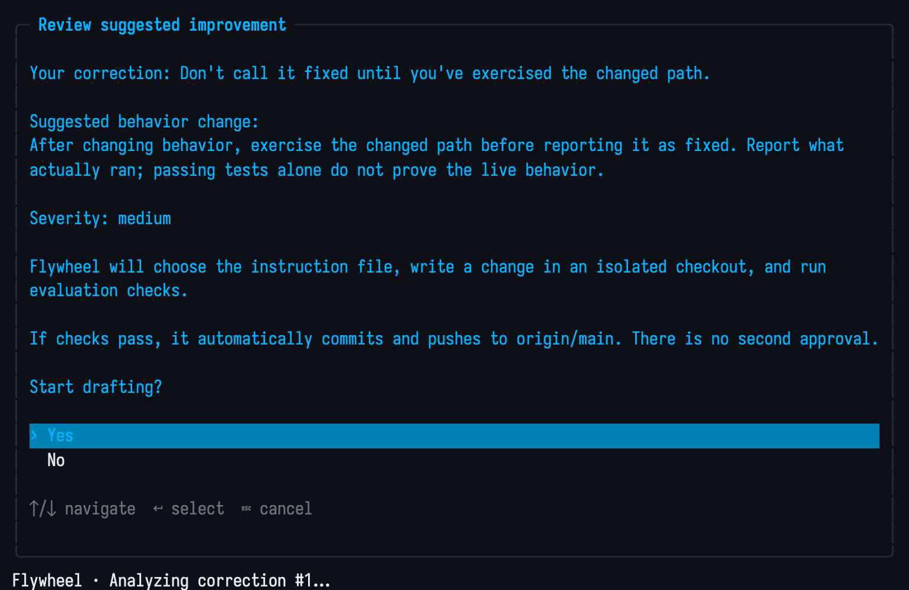
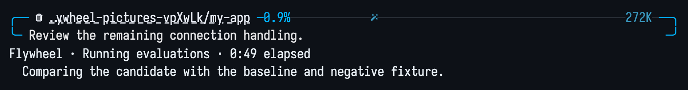

# OMP Flywheel

A dashboard for reviewing corrections and drafting instruction changes with [Oh My Pi (OMP)](https://github.com/can1357/oh-my-pi) and [Agent Flywheel](https://github.com/fmguerreiro/agent-flywheel).

## Install and configure

Requires OMP, [uv](https://docs.astral.sh/uv/), Python 3.11+, and Git. Verified with OMP 18.11.1.

```sh
uv tool install git+https://github.com/fmguerreiro/agent-flywheel.git
omp plugin install github:fmguerreiro/omp-flywheel
```

[Configure the backend](https://github.com/fmguerreiro/agent-flywheel#configuration) with your instruction repository, staged instruction paths, transcript sources, and sandbox before drafting. Configuration defaults to `~/.local/share/agent-flywheel/flywheel.toml`; `AGENT_FLYWHEEL_HOME` overrides its directory. Without configuration, it assumes `~/projects/dotfiles`.

Populate and check the local store:

```sh
agent-flywheel ingest --since 7d --derive-signals
agent-flywheel snapshot --json
```

The dashboard reads this store without ingesting transcripts or starting background automation. To override the executable:

```sh
export AGENT_FLYWHEEL_CLI=/path/to/agent-flywheel
```

## Use the dashboard

Restart OMP, then use `/flywheel` or `Ctrl+Shift+F`. Without open corrections, saved candidates appear first. The dashboard loads up to 20 candidates, showing loaded/total counts, proposed changes, severity, draft status/errors, and next steps.

| Key | Action |
| --- | --- |
| `j` / `k` | Select a correction or candidate |
| Tab | Switch between corrections and candidates when both exist |
| `x` | Reject the selected correction |
| `p` | Analyze the selected correction |
| `d` | Draft the selected candidate; no case ID needed |
| `r` | Refresh |
| Escape | Close |

Closing restores the editor and unsent text. Dialogs temporarily close the dashboard. Legacy and Kitty keyboard input are supported.

## Draft and publish

Analysis suggests behavior changes, severity, and grouping labels from full stored evidence without changing files or saved corrections. It uses your selected OMP model or Flywheel's runner settings (built-in default: OMP's configured model, unless overridden).

**One confirmation authorizes an isolated checkout, edits, evaluation, and automatic commit/push to `origin/main` if checks pass. There is no second approval.** Confirming a proposal saves a candidate and starts drafting immediately.

Drafting restores the editor. Progress shows phase, model/tool activity, and elapsed time, not percentages. The CLI needs `draft --progress-file PATH` and `triage-promote --json` responses with `schema_version: 1`, `signal_id`, and `case_id`. Private temporary progress files are removed afterward. Drafts time out after 15 minutes and notify you of completion or failure.

Running drafts cannot restart. Failed or blocked drafts can be retried with confirmation; failed proposal drafts leave their saved candidate selected. `fixed` means already published, not awaiting review.

Stored evidence, candidate descriptions, and errors have terminal escapes/control characters removed; Markdown line breaks remain. Correction/candidate JSON pages allow 1 MiB, including escaped Unicode; snapshots allow 64 KiB.

## Screenshots

Captured in OMP with sample feedback. Model analysis and evaluation progress are simulated; no instruction edits or publication.






